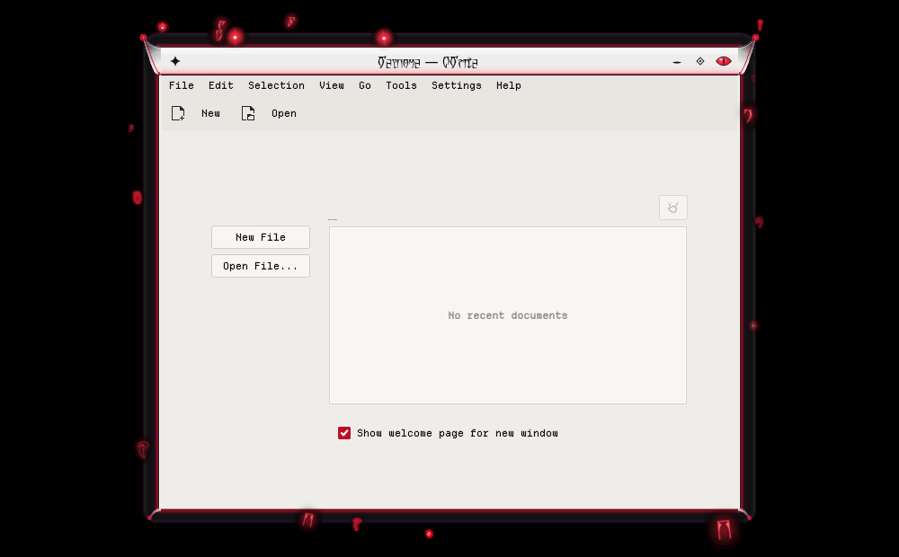
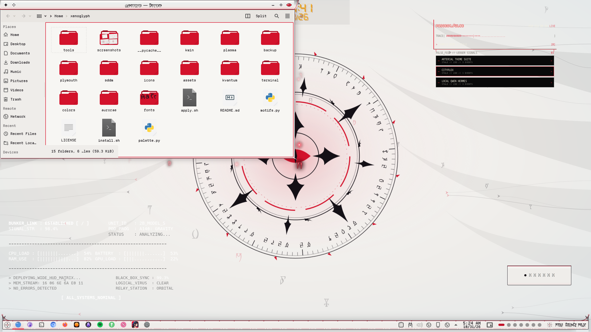

# Xenoglyph — Floating Runes (KWin Script)

Small glowing Daedric runes, embers and sparks haunt the active window: some orbit it, some rise off its edges and burn out, some flare in place.



Xenoglyph is an alien-white, cybertribal look for KDE Plasma 6: pearl and bone surfaces, black tribal ink that sweeps into fins, horns and claws, a red ichor seam through everything, Daedric script, and motion everywhere.

## Features

- 19 motes, 12–26 px, in three looks: hot red **embers** with a pale core, black **ink** runes with a thin red halo, and faint red **ghost** outlines, plus star-glint sparks.
- Three motions: slow orbits at different distances, embers that lift off the edges and burn out and reappear elsewhere, and twinkles that flare and fade in place.
- Follows the active window. It is hidden for maximised, fullscreen and non-normal windows.
- One click-through overlay on a 20 fps clock, with pre-rendered sprites, so it costs next to nothing and only runs while visible.



## Requirements

KWin (Plasma 6).

## Install

```bash
git clone https://github.com/numbpill3d/xenoglyph-runes
cd xenoglyph-runes && ./install.sh
```

Or from the KDE Store: Extract to `~/.local/share/kwin/scripts/`, then enable **Xenoglyph Runes** in System Settings → Window Management → KWin Scripts.

## The rest of the suite

| piece | repo |
|---|---|
| SDDM login | [xenoglyph-sddm](https://github.com/numbpill3d/xenoglyph-sddm) |
| Plymouth boot splash | [xenoglyph-plymouth](https://github.com/numbpill3d/xenoglyph-plymouth) |
| Global theme + splash screen | [xenoglyph-global](https://github.com/numbpill3d/xenoglyph-global) |
| Plasma style (panel, popups) | [xenoglyph-plasma](https://github.com/numbpill3d/xenoglyph-plasma) |
| Aurorae window decoration | [xenoglyph-aurorae](https://github.com/numbpill3d/xenoglyph-aurorae) |
| Window open/close animation (KWin effect) | [xenoglyph-unfurl](https://github.com/numbpill3d/xenoglyph-unfurl) |
| Animated + still wallpaper | [xenoglyph-wallpaper](https://github.com/numbpill3d/xenoglyph-wallpaper) |
| Sigil clock widget | [xenoglyph-sigil](https://github.com/numbpill3d/xenoglyph-sigil) |
| Colour scheme | [xenoglyph-colors](https://github.com/numbpill3d/xenoglyph-colors) |
| Kvantum widget style | [xenoglyph-kvantum](https://github.com/numbpill3d/xenoglyph-kvantum) |
| Icon theme | [xenoglyph-icons](https://github.com/numbpill3d/xenoglyph-icons) |
| Konsole + kitty colours | [xenoglyph-konsole](https://github.com/numbpill3d/xenoglyph-konsole) |

Everything at once, with the generators: [xenoglyph](https://github.com/numbpill3d/xenoglyph).

## Tags

`xenoglyph` `kde` `kde-plasma` `plasma6` `light-theme` `white` `red` `cybertribal` `tribal` `alien` `daedric` `otherworldly` `animated` `kwin-script` `kwin` `runes` `particles` `glow`

## Credits and licence

By splicer scorn (voidrane). GPL-3.0-or-later.
